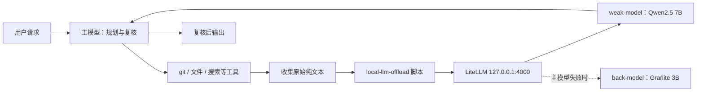

# HybridBrain-OS

**本地文本处理 + 云端强模型工具调度**的可移植混合 AI 参考实现。把重复、批量、以文本为主的工作交给本机 Qwen；由主模型负责工具调用、收集原始内容和结果复核。

> 默认服务只监听本机回环地址。发布或团队部署前，请自行审核安全策略、环境变量和许可证适配情况。仓库不包含模型权重、个人配置、API 密钥或用户数据。

## 痛点对比

| 方案 | 优点 | 代价与边界 |
|---|---|---|
| 纯云端 | 工具调用和复杂推理能力强，部署简单 | 大批量摘要、清洗和初稿会消耗较多云端输入/输出 Token；敏感文本需离开本机 |
| 纯本地 | 数据可留在本机，重复文本任务成本低 | 小型本地模型不适合复杂工具调度、深度推理和高风险判断；需自行维护模型与运行环境 |
| **HybridBrain-OS** | 云端主模型取数和调用工具，本地模型处理收集后的纯文本；按任务边界分工 | 需要本机模型、LiteLLM 网关及客户端规则接线；输出仍需主模型复核 |

## 架构



**工具调用安全边界：** `weak-model` / `local` profile 不得规划或执行多步自主 Tool Calling。主模型执行 `git log`、文件读取、搜索等调用，取得所需文本后，再将纯文本交给本地脚本。不要把仓库操作、文件路径或“去找更多资料”的任务发给本地弱模型。

## 5 分钟快速安装

前置条件：Windows、Python 3.10+、Ollama 可执行文件，以及可容纳所选模型权重的本地磁盘。 首次下载模型权重的时间取决于网络和磁盘，可能超过 5 分钟。

1. 下载或克隆本仓库，并在 PowerShell 进入仓库根目录：

   ```powershell
   git clone <PUBLIC_REPOSITORY_URL> HybridBrain-OS
   Set-Location .\HybridBrain-OS
   ```

2. 运行一键安装器：

   ```powershell
   Set-ExecutionPolicy -Scope Process Bypass
   .\install.ps1
   ```

3. 安装器会检查 Python，创建 `gateway/.venv`，安装固定版本 LiteLLM，设置用户级 `OLLAMA_MODELS`、`OLLAMA_HOST` 和 `LITELLM_MASTER_KEY` 环境变量，并询问是否拉取 `qwen2.5:7b` 与 `granite-3b`。首次安装时请提供 `ollama.exe` 的位置。
4. 确认 `gateway/install_autostart.ps1` 将两个静默 VBS 启动项写入 Windows Startup：CPU 版 Ollama 和 LiteLLM 网关。新设置的用户环境变量如未被当前桌面会话继承，请注销并重新登录。
5. 查看服务状态并发起本地文本请求：

   ```powershell
   Get-NetTCPConnection -State Listen -LocalPort 4000
   $env:LITELLM_MASTER_KEY = [Environment]::GetEnvironmentVariable('LITELLM_MASTER_KEY', 'User')
   python .\skills\local-llm-offload\scripts\ask_local.py `
     --prompt '用中文概括：服务启动成功，HTTP 200。'
   ```

安装脚本会把随机网关密钥存入当前 Windows 用户环境，不会写入仓库。`OLLAMA_MODELS` 缺省为项目内 `models/`；可在用户环境变量中改为其他目录。模型目录、日志、`.env` 和虚拟环境均被 Git 忽略。

## 六类自动分流触发词

下列为 **94 个中英文触发短语**（47 个中文、47 个英文）。按意图匹配，不要求逐字命中；实际分流对象是已由主模型收集的纯文本。

| 类别 | 中文触发词 | English triggers |
|---|---|---|
| 日志诊断 | 查日志、看报错、分析日志、提取异常、过滤错误、日志摘要、崩溃原因、排查日志 | check logs, inspect errors, analyze logs, extract exceptions, filter errors, log summary, crash cause, troubleshoot logs |
| 文档归纳 | 总结文档、提炼要点、归纳笔记、整理收件箱、提取待办、会议纪要、长文浓缩、汇总资料、核心观点 | summarize documents, extract key points, consolidate notes, triage inbox, extract action items, meeting minutes, condense long text, consolidate materials, key takeaways |
| 数据清洗 | 清洗数据、提取字段、转成表格、整理成 JSON/CSV、格式化输出、文本去重、分类归档、信息抽取 | clean data, extract fields, convert to table, format as JSON/CSV, format output, deduplicate text, classify and archive, information extraction |
| 代码辅助 | 加注释、生成注释、补全 docstring、写单测、生成测试用例、解释代码、写 README、接口文档初稿 | add comments, generate comments, complete docstrings, write unit tests, generate test cases, explain code, write a README, draft API documentation |
| 翻译本地化 | 批量翻译、双语对照、翻译字幕、润色邮件、英译中、中译英、文案本地化、改写初稿 | batch translation, bilingual alignment, subtitle translation, polish emails, English to Chinese, Chinese to English, copy localization, rewrite a draft |
| 内容变体 | 批量改写、生成标题、提取标签、开发信初稿、文案变体、拆解文案 | batch rewriting, generate headlines, extract tags, outreach email draft, copy variants, break down copy |

## 日常用法

先让主模型完成取数，例如从版本历史提取提交摘要，再交给本地模型处理纯文本：

```powershell
$raw = git log -5 --format='%h %s'
$prompt = "用中文归纳以下 Git 提交主题：`n$($raw -join "`n")"
$env:LITELLM_MASTER_KEY = [Environment]::GetEnvironmentVariable('LITELLM_MASTER_KEY', 'User')
python .\skills\local-llm-offload\scripts\ask_local.py --prompt $prompt
```

## 本机实测说明

参考实测：Qwen2.5 7B 通过本地网关完成三条提交主题摘要，脚本调用耗时约 **37.5 秒**；Codex Responses API 请求曾返回 **HTTP 200**。这是单机、单次的小样本观测，不是性能承诺。CPU、模型是否已加载、上下文长度和磁盘速度都会影响耗时。实际省下的云端 Token 数取决于客户端如何收集和传递文本；本项目不承诺固定节省比例。

## 目录结构

```text
brain/                         通用调度规则与可定制画像模板
gateway/                       LiteLLM YAML、CPU Ollama 和静默自启脚本
skills/local-llm-offload/      可分发技能与纯文本请求脚本
sync_clients.py                规则和技能的备份同步器
install.ps1                    Windows 一键部署入口
models/                        本地模型权重（Git 忽略）
```

## 环境变量

| 变量 | 用途 | 默认行为 |
|---|---|---|
| `LITELLM_MASTER_KEY` | 本地网关认证 | 安装器生成并保存到用户环境 |
| `OLLAMA_MODELS` | Ollama 模型目录 | `./models` 对应的安装目录 |
| `OLLAMA_HOST` | Ollama 监听地址 | `127.0.0.1:11434` |
| `OLLAMA_BASE_URL` | LiteLLM 到 Ollama 的 URL | 由 `OLLAMA_HOST` 生成 |
| `OLLAMA_EXE` | Ollama 可执行文件 | 安装时检测或交互询问 |

`gateway/router_config.yaml` 路由别名为 `weak-model`（权重 9）和 `back-model`（权重 1）；主模型失败时配置自动 fallback。LiteLLM 依赖固定为 1.109.1，升级前请在目标环境单独验证配置兼容性。

## 发布前检查

- 不提交 `.env`、密钥、模型、日志、个人数据、真实联系信息或绝对机器路径。
- 运行 `python sync_clients.py --dry-run` 检查客户端目标，再运行 `python sync_clients.py` 执行备份同步。
- 在目标机器运行 `install.ps1`，检查模型路由、网关响应和启动项。
- 阅读 `LICENSE` 并按团队要求调整版权声明。

## License

本项目按 MIT License 发布，详见 [`LICENSE`](LICENSE)。
